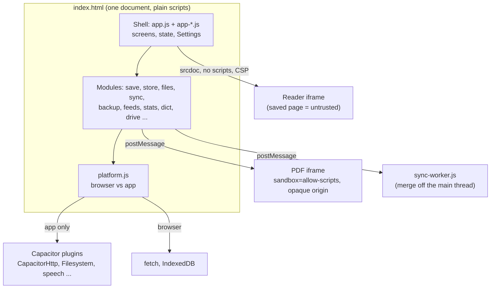

# Architecture

How Waypage's code fits together. Describes **1.45.7**. Read from the
source: every file, export and load-order claim below was checked against
`index.html` and the `src/` headers. For *why* the design is this way see
[PROPOSAL.md](PROPOSAL.md) (the original proposal, written as Carry-on) and
[NOTES.md](../NOTES.md); for what's stored see FORMATS.md, for the save and
read path see PIPELINE.md, for working on it see DEVELOPING.md.

## What runs where

There is one set of files. A browser loads `index.html` and the scripts in
`src/`; the Android and iOS apps are the same files copied into a
[Capacitor](https://capacitorjs.com) shell by `tools/build-www.js`. There
is no build step for the code itself and no dependencies.

The two differ only in `src/platform.js`: in the app, page fetches go
through CapacitorHttp and pictures through `Filesystem.downloadFile`, both
native and not subject to CORS, so any page can be read without a server.
In a browser they fall back to `fetch`, which CORS blocks for most sites.
Everything else asks `platform.js` (`window.Waypage.platform`) rather than
checking where it is running.

## How the scripts share code

`index.html` loads plain scripts (not ES modules), in this order. Each
module is an IIFE that registers itself on **`window.Waypage`** (`C` in the
code); `platform.js` creates the object, the rest add to it.

| Order | File | Registers | Job |
| --- | --- | --- | --- |
| 1 | `platform.js` | `C.platform` | Browser vs app: native fetch, downloads, speech, links, notifications |
| 2 | `motion.js` | `C.motion` | Springs sampled into CSS `linear()` curves (DESIGN.md §4) |
| 3 | `vendor/Readability.js` | (global) | Picks the article out of a page |
| 4 | `store.js` | `C.store` | Page folders and `library.json`; IndexedDB in a browser |
| 5 | `save.js` | `C.save` | A link to a saved page: Wikipedia adapter, Readability, allowlist cleaner, picture previews, video cards, serial chapters |
| 6 | `feeds.js` | `C.feeds` | RSS 2.0, RSS 1.0, Atom, JSON Feed into one shape |
| 7 | `backup.js` | `C.backup` | One page as HTML, the whole library as a zip, Markdown export, restore |
| 8 | `imports.js` | `C.imports` | Pocket, Instapaper, Omnivore, Raindrop, Wallabag exports; OPML |
| 9 | `dict.js` | `C.dict` | StarDict dictionaries kept on the device, looked up offline |
| 10 | `sync.js` | `C.sync` | Library kept in step between devices through a private GitHub repo |
| 11 | `drive.js` | `C.drive` | Backups in Google Drive |
| 12 | `qr.js` | `C.qr` | QR encoder for sync's setup link, so the token never goes to a QR service |
| 13 | `stats.js` | `C.stats` | Reading time, words, clips opened and finished |
| 14 | `epub.js` | `C.epub` | Clips as an EPUB 3 book |
| 15 | `files.js` | `C.files` | EPUB, Kindle (MOBI/AZW3), FB2, CBZ, Markdown, text, HTML and PDF files become clips |
| 16 | `pdf.js` | `C.pdf` | PDFs through pdf.js in a locked-down frame |
| 17 | `pptx.js` | `C.pptx` | A PowerPoint deck redrawn slide by slide on a canvas and written as a PDF with an invisible text layer |
| 18 | `reader.js` | `C.reader` | Shows a saved page in the sandboxed iframe: position, find, pages, highlights painting |
| 19-26 | `app.js`, `app-*.js` | (the shell) | See below |

Plus, outside the page's scripts: `sync-worker.js` (a Worker that
`importScripts` `backup.js` and `sync.js` and runs the three-way merge) and
`vendor/foliate-mobi.js`, `vendor/pdf.min.mjs`, `vendor/pdf.worker.min.mjs`
(each with its licence beside it).

Dependencies run downward: a module may use ones earlier in the list
(`save.js` uses `platform` and `store`; `sync.js` uses `backup` for
`cleanMeta`), never later ones. The shell uses all of them.

## The shell

The shell is seven plain scripts, loaded in this order. They are **not
modules**: what one declares at its top level (`const`, `let`, `function`)
the later ones see, as one scope. The rule that keeps it working, from the
header of `app.js`:

> What runs at load, rather than later on a tap or a timer, may only use
> what an earlier part, or its own, has declared. A part's functions can
> call into any part, since nothing is tapped until all of them have
> loaded.

| Part | File | Holds |
| --- | --- | --- |
| 1 | `app.js` | `APP_VERSION`, themes and their keys, state, the library list and the shared helpers (`el`, `toast`, `load`; storage goes through `C.store`) |
| 2 | `app-reader.js` | Moving between screens, the reader around the page (brightness, contents, Narrate, highlights, its sheets), the image viewer |
| 3 | `app-library.js` | Tags, collections, what a clip keeps, picking several, the library's sheets, export, import, watched folders |
| 4 | `app-saving.js` | Sync, saving several, next links and new chapters, feeds, home screen widgets |
| 5 | `app-places.js` | The Highlights place, the sidebar, big screens, keys, gestures, a feed's sheets |
| 6 | `app-settings.js` | Settings (each group is data: a new setting is a new entry, not new markup), making room, Report a problem |
| (extra) | `app-lock.js` | App lock: passcode as a PBKDF2 hash, fingerprint or face on Android; per device, never synced |
| 7 | `app-start.js` | Wiring the page up, what other apps share in, the app updating itself, What's new. Runs last |

(`app-lock.js` was added later (1.38.0) and isn't numbered in the file
headers, which still say "part N of 7". It loads before `app-start.js`.)

**Where a change goes**

- A new **setting**: an entry in the groups in `app-settings.js`.
- A new **screen or sheet**: its code in the part that owns the area
  (library sheets in `app-library.js`, reader sheets in `app-reader.js`),
  its markup in `index.html`, its tokens in `src/styles.css` (see
  DESIGN.md).
- A new **file in `src/`**: a `<script>` in `index.html` (with the `?v=`),
  and an entry in `sw.js`'s `ASSETS`, which is also what goes into the
  apps. The build fails if `index.html` loads a file `ASSETS` lacks.
- A new **stored field**: FORMATS.md says where it lives and whether it
  syncs.

## Trust boundaries

Saved HTML is **untrusted** (CLAUDE.md). A script in the app's own
document could reach the Capacitor plugins and every saved clip, so:

- **Reader.** `reader.js` puts the page in an iframe via `srcdoc`, with no
  `allow-scripts`, under `default-src 'none'; img-src 'self' https: data:
  blob:; style-src 'self'; font-src 'self'; base-uri 'self'; form-action
  'none'` (`reader.js`, `CSP`). The shell reads and decorates the frame's
  document (position, highlights, find); the page can't run anything.
- **PDF.** `pdf.js` runs pdf.js in an iframe with `sandbox="allow-scripts"`
  and no `allow-same-origin`, so it has an opaque origin, and the shell
  talks to it by `postMessage`.
- **Sync merge.** The Worker holds no page or storage; it is given data and
  returns the merge.
- **Nothing leaves the device** unless the user turned on GitHub sync or
  Google Drive; Translate runs on the device.

The table of which file enforces which boundary, and which test covers it,
is in PIPELINE.md.

## Other top-level pieces

| Path | What |
| --- | --- |
| `index.html` | App shell markup; the `?v=` on every script and stylesheet |
| `sw.js` | Offline cache for the web copy (`CACHE`, `ASSETS`) |
| `manifest.json` | Web app manifest |
| `src/styles.css`, `reader.css`, `fonts.css` | Tokens and themes; the saved page inside the frame (a dark PDF's pages get an SVG colour-map filter from `reader.js` `pdfDarkFilter`, 1.46.0); bundled fonts |
| `native/share/` | Capacitor plugin: Android's share sheet into the app |
| `tools/` | `build-www.js`, Android and iOS project patches, APK signing, `shots.js` |
| `test/` | `node test/run-all.js` |
| `server.js`, `start.cmd` | Static server for local use (port 5173) |

## What this doc doesn't cover

Feature behaviour (README.md), the look (DESIGN.md), and per-version
reasoning (NOTES.md). The exports listed for each module in the source
are many; the table names only the object each registers on `C`. To see
a module's API, read the object assigned at the bottom of its file
(`C.save = { ... }` in `save.js`, and so on).
