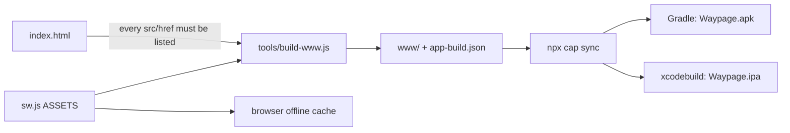

# Developing Waypage

How to work on it: run it, test it, build it, ship it.

This describes **APP_VERSION 1.45.7** (`src/app.js`). Commands and paths
below were checked against the files at that version. What was run here
and what was only read is said where it matters.

Read CLAUDE.md first for the standing rules, and
[PROPOSAL.md](PROPOSAL.md) before changing architecture.
[ARCHITECTURE.md](ARCHITECTURE.md) maps the code.

## You need

- **Node.js.** To run the app, the server and the unit tests: nothing
  else. There is no `npm install` for the web app. CI uses Node 22.
- **Playwright with a Chromium**, only for `test/ui.test.js`,
  `test/drive.test.js` and `tools/shots.js` (below). It is not a
  dependency of the repo.
- **`npm ci`**, only for the native build and for the two native-file
  checks in `test/build.test.js`. `package.json` lists Capacitor and its
  plugins as `devDependencies` and nothing else.

## Running it

```bash
node server.js
```

Open <http://localhost:5173>. On Windows, double-click `start.cmd`: it
opens that address and starts the same server.

`server.js` is a static file server with no dependencies. The port is
`process.env.PORT`, default 5173. It serves files from the repo root and
refuses paths outside it. Edit a file, reload the page. There is nothing
to rebuild.

Two things get in the way of a reload:

- **The service worker** (`sw.js`) caches the app and serves the cached
  copy first. After a change, bump the `?v=` and `CACHE` as the release
  flow says, or hard-reload / clear the site's data in DevTools.
- **Version strings.** `index.html` loads every file with `?v=<version>`.

### The browser copy and the app

It is the same files. The differences are small and all live in
`src/platform.js`:

| | Browser (`node server.js`, the web copy) | The phone app |
|---|---|---|
| Fetching pages | `fetch`, which CORS blocks for most sites | CapacitorHttp and `Filesystem.downloadFile`, which CORS doesn't apply to |
| `platform.canFetchPages` | false | true |
| Email addresses and feed refreshing | A phone collects; saved ones reach a browser through sync (app-places.js) | Works on the device |
| `index.html` | As in the repo | `viewport-fit=cover` and `class="native"` added by `tools/build-www.js` |
| `app-build.json` | Absent, `platform.build` is null | In the bundle: version, repo, web address |
| Storage | The browser's | The app's own, on the device |

So in a browser you can work on the interface, the reader, the library,
settings, sync's merge and the file readers. You can't save an arbitrary
web page: to try saving, use pages served from the same origin, such as
`test/fixtures/article.html`, which is what the UI test does.

## Tests

```bash
node test/run-all.js
```

Runs every `test/*.test.js`, one Node process per file, and prints
`FAILED: <files>` or `All N test files passed.`. `npm test` does the same.
You can run a single file with `node test/<name>.test.js`.

| File | What it covers |
|---|---|
| `build.test.js` | The native build and release bookkeeping, without an Android SDK or a Mac: every file `index.html` and the stylesheets load is in `sw.js`'s `ASSETS`; `CHANGELOG.md`'s newest entry and every `?v=` equal `APP_VERSION`; `versionCode` rises with each version; the Android manifest patch, the share target, the updater, the iOS `AppDelegate`/`Info.plist` edits, and that ids agree across Android, iOS and the workflows |
| `contrast.test.js` | Every theme's text tokens in `styles.css` meet WCAG AA (4.5:1) on their grounds |
| `drive.test.js` | Google Drive backups in a browser, against a fake sign-in page and Drive API in the file: connect, back up, keep the last three, restore into an empty library |
| `files.test.js` | The pure parts of your own files: the Markdown and plain-text rules (EPUB and comics need a browser) |
| `imports.test.js` | Reading other apps' exports, the CSV kinds (Pocket's HTML and Omnivore's zip are read in the browser by `ui.test.js`) |
| `save.test.js` | Saving's pure rules (what gets fetched) and the reader's sandbox |
| `sync.test.js` | Sync's merge: two devices changing the library at once, against the last library both saw |
| `syncbatch.test.js` | Sync sending in batches, against a small GitHub in memory (refs, commits, trees, blobs) |
| `ui.test.js` | The app in a browser: saves, reads, highlights and searches `test/fixtures/` pages, opens the app in all three themes at phone and desktop width, and fails on any page error (80 `test(` calls at this version) |

`test/fixtures/` holds the pages these tests save.

### Playwright

`ui.test.js` and `drive.test.js` start `server.js` on a random port, then
drive Chromium. They look for `playwright` with `require`, then
`/opt/node-tools/node_modules/playwright`, and `PLAYWRIGHT_MODULE` (a
path) is tried first if set. **If Playwright isn't found, they print
`skip` and exit 0.** A green `run-all` on a machine without it hasn't run
the UI test.

`tools/shots.js` needs the same (it requires `PLAYWRIGHT_MODULE` or
`playwright` and fails if missing). Set it with:

```bash
PLAYWRIGHT_MODULE=/path/to/node_modules/playwright node test/ui.test.js
```

Two more switches in `ui.test.js`: `ONLY=<text>` runs only the tests
whose name contains it, and prints the full error.

### What was run here

`node test/run-all.js` was run on a checkout with no `node_modules` and
no Playwright. Every file passed except two tests in `build.test.js`
("the AppDelegate registers the feed check at launch, once" and "the app
icon's shortcuts are wired up on Android and iOS"). They read
`node_modules/@capacitor/cli/assets/ios-pods-template.tar.gz` with `tar`,
so they need `npm ci` first. Under Git Bash on Windows the `tar` call may
also trip on the `C:` in the path (a guess; not checked with
`node_modules` present). `ui.test.js` skipped. `drive.test.js` was not
separately inspected for its output.

## Screenshots

```bash
node tools/shots.js              # every section
node tools/shots.js reader skim  # only these sections
```

Starts the server, saves the demo pages in `tools/shots/demo/` through
the app's own save path, and writes phone (390 px) and desktop (1280 px)
pictures into `docs/shots/`. Section names are the keys of `SHOTS` in
`tools/shots.js`. A new README section needs a Contents line and a
`SHOTS` entry there. Look at the new pictures before committing.

## Building the bundle

```bash
node tools/build-www.js
```

Copies the app into `www/` (git-ignored), which Capacitor wraps. It also
writes `www/app-build.json`.



**`sw.js`'s `ASSETS` is the one list of what the app is made of.** The
browser caches exactly those files, and the build copies exactly those
files. So:

- A file added to or removed from `src/` (script, style, font, vendored
  file) goes in or out of `ASSETS` in the same change.
- The build **fails** if `index.html` loads a local file that `ASSETS`
  lacks, or if `ASSETS` lists a file that doesn't exist.
- `test/build.test.js` checks the same for scripts in `src/` and for
  fonts that `styles.css` loads.
- `CHANGELOG.md` is in the list too (the app shows it).

`tools/build-www.js` edits one thing on the way: the app's `index.html`
gets `viewport-fit=cover` and `class="native"`, so it draws edge to edge
from the first frame. The web copy keeps neither.

`npm run build:www` and `npm run android:sync` (build, then `npx cap
sync android`) are in `package.json`. To build locally, as README says:
`npm install`, `npm run android:sync`, open `android/` in Android Studio.
`android/` and `ios/` are generated by Capacitor and git-ignored.

### Other native tools

| File | Job |
|---|---|
| `tools/android-manifest.js` | Patches the generated Android manifest (updater permission, share target) |
| `tools/android-version.js` | Stamps `APP_VERSION` into the Android project; `versionCode` = major·1,000,000 + minor·1,000 + patch (1.45.7 is 1045007). Fails if the template's lines moved |
| `tools/sign-apk.sh` | Signs the release APK |
| `tools/ios-project.js`, `tools/ios-extensions.rb` | Adjust the generated iOS project; add the share extension and widgets targets |
| `native/share/` | The local Capacitor plugin (Android and iOS), plus the iOS share extension and widgets |

## The workflows

`.github/workflows/android.yml` and `ios.yml`. Both:

- run on push to `main` and to `claude/**` branches, and by hand
  (`workflow_dispatch`);
- **skip pushes that touch only** `**.md`, `test/**` or `.claude/**`
  (`paths-ignore`). A docs-only or test-only push builds nothing;
- cancel an older run of the same ref when a new one starts.

**Android** (ubuntu): `npm ci`, `build-www`, `cap add android`, patch the
manifest, make icon and splash, stamp the version, `cap sync`,
`./gradlew assembleRelease`, sign, upload the APK as a run artifact.
It then **publishes a release** `app-v<version>` only when the push is to
`main`, the APK was signed with the real key, and that release doesn't
exist yet. The release notes are the `## [<version>]` entry of
`CHANGELOG.md`. So a push to `main` with an unchanged `APP_VERSION` builds
but publishes nothing.

**Signing secrets** (repository secrets):

- `ANDROID_KEYSTORE_B64`: the `.jks` keystore, base64.
- `ANDROID_KEYSTORE_PASSWORD`: the store's password, which is also the
  key's.
- The key **alias must be `carryon`** (the name from before the rename;
  swapping keys is a separate step). `sign-apk.sh` checks it and stops
  with a "Wrong signing key" error otherwise.

Without the secrets the APK is signed with a throwaway key, so it
installs for trying but a later build won't install over it. The run
artifact is named `...-throwaway-key` and nothing is published. With the
real key it is `...-release-key`.

**iOS** (macos-15): same bundle, `cap add ios`, project tweaks, the two
extensions, icon and splash, `cap sync`, `xcodebuild` with no signing,
then ad-hoc `codesign` of frameworks, extensions and app (the signature
carries the App Group entitlement), zipped as `Waypage.ipa`. There is no
Apple developer account, so AltStore or SideStore re-sign it on install.
It attaches the IPA to the Android release, waiting up to 20 minutes for
it, and only on `main` with the signing secrets set (it reads the same
secrets, since without them Android publishes nothing to wait for).

Neither workflow was run for this document. The above is from reading
the files.

### The web copy

CLAUDE.md says a push to `main` deploys the web copy. There is no deploy
workflow in `.github/workflows/`; `app-build.json` assumes GitHub Pages
(`https://<owner>.github.io/<repo>/`), so the deploy is presumably Pages
set up in the repository's settings. That is a guess; it can't be seen
from the repo.

## Releasing

Follow `.claude/skills/release-checklist/SKILL.md` for every change. In
short:

1. Bump the version in three places: `APP_VERSION` in `src/app.js`, the
   `?v=` on every tag in `index.html`, and `CACHE` in `sw.js`
   (`waypage-vN` to `vN+1`).
2. Add the `## [x.y.z] - YYYY-MM-DD` entry to `CHANGELOG.md`.
3. Update the notes files, the README section and its pictures, and the
   file in `docs/` that the change touches.
4. `node --check` the edited `.js` files, then `node test/run-all.js`.
5. Check at phone (390 px) and desktop (about 1280 px) width in Paper,
   Sepia and Night, with no console errors.
6. Commit and push to `main`. Then check that the Android and iOS runs
   went green.

`build.test.js` catches a version that disagrees between `APP_VERSION`,
`CHANGELOG.md` and the `?v=` tags, which is the usual slip.

## The notes files

| File | Role |
|---|---|
| `TODO.md` | Only what is left. Shipped or declined work leaves it in the same change |
| `DONE.md` | What the app already does: one line per feature, by area, with the version |
| `NOTES.md` | Why things are the way they are, newest first, each entry a bold title with its version. Starts with the rules every release keeps |
| `DROPPED.md` | What was decided against, with the reason, so it can come back if the reason stops being true |
| `CHANGELOG.md` | User-facing words per version. The newest entry must match `APP_VERSION`; the release workflow copies it into the GitHub release |
| `DESIGN.md` | The design language: tokens, scales, motion, contrast |

Check DONE, TODO and DROPPED before suggesting an idea. CLAUDE.md also
says the shared project folder's `waypage/TODO.md` and `DONE.md` are
copies to refresh after changing either.

## Only on a phone

A browser can't check these. Say so in the release report when a change
touches them and wasn't run on a device.

- **Saving a page and its pictures.** CapacitorHttp and `Filesystem` don't
  exist in a browser; there, `canFetchPages` is false.
- **Opening and reading files and PDFs** saved to the device's storage
  through the native Filesystem, and the "Open in" / file opener.
- **The share sheet**: Waypage as a share target on Android, and the iOS
  share extension.
- **Home-screen widgets** (Android and iOS) and **icon shortcuts**.
- **Background feed checks** (the iOS task, Android's equivalent) and
  collecting email addresses.
- **The in-app updater**, which downloads the release APK.
- **Edge to edge drawing** under the status and gesture bars, and safe areas.
- **The setup-code scanner** (ML Kit barcode scanning).
- **Volume-button page turning**; a computer uses keys instead.
- **Install and update over the old app**, which depends on the signing
  key and `versionCode`.
- **Google Drive sign-in on a phone**: `drive.test.js` uses a fake. iOS has
  no Drive plugin yet (TODO.md).

This list is from reading the code and README, not from running a
device; trust the source over it where they differ.
