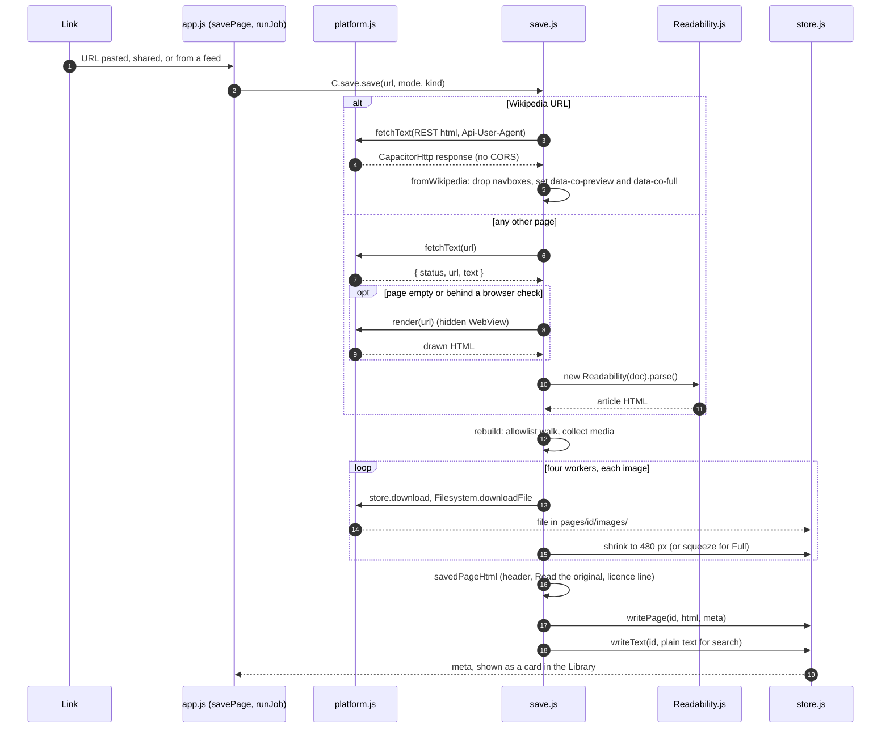

# The save and read pipeline

How a link becomes a saved clip, and how a clip is read.

Describes **`APP_VERSION` 1.45.7** (`src/app.js`). Names were checked against
the source at that version. "Checked" below means I read the code or a test
that asserts it. "Not checked" means I did not run it or find a test.

For why there is no server, see [PROPOSAL.md](PROPOSAL.md). For the code map,
see [ARCHITECTURE.md](ARCHITECTURE.md). For what is written to disk, see
FORMATS.md. For the reasoning behind each choice, see [../NOTES.md](../NOTES.md).

## Saving a link

`savePage` (`src/app.js`) makes a job and `runJob` runs it. `runJob` calls
`C.save.save` in `src/save.js`, which does the work below. Everything happens
on the device.

### Step by step

1. **Fetch.** `C.platform.fetchText` (`src/platform.js`). In the app it is
   `CapacitorHttp.request`, so CORS does not apply, with the app's User-Agent and
   a 30 s deadline. In a browser it falls back to `fetch`, which only works for
   sites that allow it. `get` in `save.js` turns a failure or a 4xx/5xx into a
   `SaveError` with a plain message. A site you are signed in to is sent its
   cookie (`signedCookie`). Not checked: how that cookie is stored; see NOTES.md.
2. **Pick a reader.** `save` sends a Wikipedia URL (`wikipediaPage`) to
   `fromWikipedia`, which calls the REST API `/api/rest_v1/page/html/…` with an
   `Api-User-Agent` naming the app. Anything else goes to `fromAnyPage`. A site
   with its own rule (`siteRule`, for example WEBTOON, Tapas, Wattpad, Blogger)
   can change the fetch address, prepare the HTML or list its own chapters.
3. **Extract.** `readArticle` runs `window.Readability`
   (`src/vendor/Readability.js`) with `charThreshold: 500`. It returns `null`
   when the text is under `MIN_TEXT` (250 characters), which is what triggers the
   JS-rendered path below. Comics skip Readability and use `comicPanels`.
4. **Clean.** `rebuild` walks the extracted DOM into a new document. It keeps only
   tags in `KEEP`, copies only attributes in `ATTRS` and `GLOBAL_ATTRS`, and
   drops everything in `DROP` (script, style, iframe, form, object and so on).
   Links keep only `http(s):` and `mailto:` addresses. Hidden nodes are
   dropped, and `h1` becomes `h2`. Nothing from the page is copied through
   by name except those.
5. **Media.** `rebuild` records each image as `{ el, preview, full }`:
   - `preview` is the srcset candidate at least 480 px wide (`pickWidth`,
     `PREVIEW_WIDTH`), or for Wikimedia a standard-width thumb
     (`wikimediaThumb`, 500 and 1280).
   - `saveImages` then downloads according to the setting: **previews** (small
     local copy, link to the full image in `data-full`), **full** (downloaded, and
     redrawn to at most 1600 px unless compression is off), or **links** (nothing
     downloaded, a placeholder with the link). In a browser the mode is always
     links.
   - A failed download is counted in `meta.missing`, keeps its link, and gets
     the `co-missing` placeholder. `retryMissing` tries again later.
   - **Videos are never downloaded.** `videoCard` makes a card with the poster or
     YouTube thumbnail and a link. The note says "Plays when you're back online".
     Only YouTube and Vimeo embeds are recognised (`youtubeId`, `vimeoId`).
   - Tracking pixels are dropped (`isTrackingPixel`).
6. **Write.** `savedPageHtml` adds the title, byline, the "Read the original"
   link and the licence line (Wikipedia's reads "CC BY-SA 4.0, by Wikipedia
   contributors"). Then `store.writePage` writes `page.html` and the meta, and
   `store.writeText` writes the plain text that search reads. If the write fails,
   `removePage` cleans up and the save fails with "Couldn't write the clip".

A link can also be read without saving: `C.save.preview` builds the same
reading copy with pictures left as links and writes nothing.

## Variants

| Case | Where | What differs |
| --- | --- | --- |
| **Files** (EPUB, MOBI/AZW3, FB2, PDF, CBZ, Markdown, text, HTML, email) | `src/files.js`, `src/pdf.js` | `C.files.bring(file, kind, …)` reads the file on the device. HTML and email go through `fromHtml` then `cleanSaved`, the same allowlist as the web, because mail and files are as untrusted as pages. EPUB, MOBI and FB2 build their own DOM. Pictures go straight to files (`picturesOut`), so a big comic never sits in memory. The clip has `meta.file`, no address, and "Opened from …" instead of "Saved from …". |
| **PowerPoint** (.pptx) | `src/pptx.js`, `convertDeck` in `app-library.js` | Not a clip kind: `kindOf` says `"pptx"` and `openFile` asks "Convert to PDF?" (Cancel stops). `C.pptx.toPdf` parses the zip's XML (never run), draws each slide on a canvas (theme, layout and master inherited; shapes, text, pictures, tables, groups), and writes a PDF by hand: a JPEG per slide plus invisible text (render mode 3, UTF-16 with a ToUnicode map). `platform.saveLinked` saves it where the person picks, with a lasting permission (Android `FileSave` with `keep`, Chrome and Edge `showSaveFilePicker`); the PDF then goes through `openFile` as a picked PDF read from where it is. A browser with no picker downloads it and opens a copy. Pictures outside the file are never fetched; charts and diagrams with no stand-in picture are counted, not drawn. |
| **PDF** | `src/pdf.js`, `fromPdf` in `files.js` | pdf.js runs in a hidden iframe with `sandbox="allow-scripts"`, no `allow-same-origin`, and a CSP that allows no network (`connect-src blob: data:`). The app and frame talk by `postMessage`. Text PDFs come back as paragraphs. A PDF with no words comes back as pages drawn as pictures. Big linked PDFs are read by ranges, not whole. |
| **Feeds** | `src/feeds.js`, `checkFeed` and `saveFeedPosts` in `src/app-saving.js` | `findFeed` finds a feed from a site's `<link rel="alternate">` or common paths, `readFeed` parses RSS, Atom and JSON Feed with `DOMParser` (nothing runs). Titles and summaries are kept as plain text (`words`). Posts are listed in Feeds, not saved. A feed set to auto-save (`autoSave`) or a picked post goes through `savePage` like any link. |
| **Newsletters** | `src/app-places.js` (`saveMail`, `mailPage`), `isMail` in `app-saving.js` | An address is a Kill the Newsletter feed (`MAIL_FEED`). The email is fetched, its settings link removed, and passed to `savePage` as `given: { url, html, title, site }`. `fromAnyPage` then reads that HTML instead of fetching (and treats it as a page, `asPage`). The confirm email waits for the user and is never auto-saved. |
| **Serials, next chapter** | `nextLink`, `findNext`, `findChapters`, `pickChapters` in `save.js`; `follow`, `checkNew`, `renderBatch` in `app-saving.js` | `readArticle` finds the next and previous links by their words and stores them in `meta.next` and `meta.prev`. `follow` saves the next one into the same collection. `findChapters` reads a contents page; `fromAnyPage` throws `ContentsPage` when it saves one, and the app opens "Save several" with the list. A collection with a source (`folderSource`) is checked for new chapters by `checkNew`. |
| **JS-rendered pages** | `fromAnyPage`, `platform.render`, `canRender` | If Readability finds nothing, or the title looks like a browser check, the page is drawn in a hidden WebView by the `PageRender` plugin (`native/share/.../PageRenderPlugin.java`, and `PageRenderPlugin.swift` exists too) and read again. Comics that fill in pictures as they scroll are drawn and scrolled to the end. The saved copy is still the cleaned HTML, not the WebView's page. Without the plugin, the error says it needs JavaScript. A page that still shows a browser check fails with "asked for a browser check". Not checked: the iOS plugin working. |
| **Paywalls** | `cutShort`, `LOCKED`, `ASKS` | Pages are fetched signed out. A short article that says it is for subscribers gets `meta.cut` and an end note "This may be only the start". |
| **Internet Archive fallback** | `findArchived`, `isArchive`, `unWayback` in `save.js`; `findArchive`, `saveArchived`, `archiveClip` in `app.js` | When a save fails with a `SaveError` whose `gone` flag is set (404, 410 or 403 from `get`), the failed job offers "Archived copy". The app asks `archive.org/wayback/available`, then `save` fetches the snapshot, strips the Wayback toolbar, sets the clip's address back to the original and records `meta.archived`. The licence line says it is the Archive's copy. |

## Reading

`openPage` and then `show` in `src/app-reader.js` hand the clip's HTML and meta to
`C.reader.open` (`src/reader.js`). The shell around the page (bars, sheets,
contents, search, the highlight bar, the Narrate player) is the app's own
document. The clip is never in it.

### The sandbox

- `index.html` declares `<iframe id="readerFrame" sandbox="allow-same-origin">`.
  There is **no `allow-scripts`**, no forms, no popups, no top navigation.
- `reader.js` `srcdoc()` puts a CSP meta tag first in the document:
  `default-src 'none'; img-src 'self' https: data: blob:; style-src 'self';
  font-src 'self'; base-uri 'self'; form-action 'none'`. There is no
  `script-src`, `connect-src` or `frame-src`, so nothing in the page can run or
  connect. Pictures may load from `https:`.
- `<base href>` is the clip's folder (`C.store.pageDirUrl(id)`), so `images/3.jpg`
  resolves to the saved file. Fonts and `reader.css` come from the app, with the
  version in the query.
- With "Pictures on tap" on (`onTapOnly`, 1.30.1), `holdPictures` moves every
  `https:` image address into `data-full` before the page is shown, so opening a
  clip online tells no site that you read it.
- Links never run in the frame. The app handles the tap (`onLink`) and
  `platform.openOutside` only opens `http(s):` and `mailto:` addresses.

### How the shell talks to the page

There is no `postMessage` to the clip. Because `allow-same-origin` is kept and
scripts are not allowed, `reader.js` reaches into `frame.contentDocument`
itself to set the theme and handle taps. Nothing inside the clip can run.

- **Theme.** `applyTheme` copies the CSS token values (`TOKENS`) onto the
  frame's root element and sets `data-co-*` attributes for alignment, hyphens
  and dimmed pictures.
- **Events.** `reader.js` adds listeners and calls back the options that
  `app-reader.js` passes in: `onTap` (toggle the bar), `onImage` (viewer),
  `onLink`, `onNote` (footnotes), `onMark` (a tap on a highlight), `onSelect`,
  `onKey`, `onPinch`, `onEdge`.
- **Pictures.** Near the screen, `swapNearImages` loads the full image over the
  preview, only when online and not in tap mode.
- **Layout.** Scroll, or Pages (columns turned by the shell, `setPaged`).

### Place, highlights, Narrate

- **Place.** `reader.js` `position()` is how far down (0 to 1), `spot()` is the
  first block in view. `onPosition` calls `notePosition` in `app-reader.js`,
  which stores `p.at` and `p.spot`, and sets `readAt`/`placeAt` only when the
  place really moved. Sync merges by `placeAt` (see `test/sync.test.js`).
- **Highlights.** `selectionMark` reads the selection as text plus offsets,
  and `paintMarks(p.marks)` wraps matches in `mark.co-mark` after the page is
  shown. The marks live in the clip's meta, not in `page.html`. A highlight
  whose words are gone (a re-save) is kept and reported as `lost`.
- **Narrate.** `readable()` lists the page's blocks (`BLOCKS`) in reading order
  with citation marks, buttons and placeholders removed (`spoken`).
  The text goes to `C.platform.speech` (`platform.js`: the Speech plugin in the
  app, `speechSynthesis` in a browser). `light(i)` marks the
  block being read with `co-speaking`, and `spotIn` finds the block for "Narrate
  from here".

## Security boundaries

The test column is the file I found asserting it. "None found" means no test
covers it as far as I looked. Read it as a gap, not as "works".

| Boundary | What it stops | Enforced by | Test |
| --- | --- | --- | --- |
| Reader iframe has no `allow-scripts` | Script in a saved page reaching the Capacitor plugins | `index.html` (`#readerFrame`) | `test/save.test.js` "the reader's iframe is sandboxed without allow-scripts"; `test/ui.test.js` "the clip opens in the reader…" |
| Reader CSP: `default-src 'none'`, no script, connect, frame | A page loading or sending anything; forms | `CSP` in `src/reader.js` | `test/save.test.js` "the reader's CSP allows no scripts, frames, forms or connections" |
| Allowlist clean on save (`KEEP`, `DROP`, `ATTRS`) | Scripts, event handlers, iframes, forms and styles being stored | `rebuild` in `src/save.js` | None found that saves hostile HTML and checks the output. |
| Allowlist clean on import (`cleanSaved`) | A hand-edited backup or synced clip carrying markup; only `data:image` or `https:` pictures, `http(s)`/`mailto` links | `cleanSaved` in `src/save.js` | None found. `test/files.test.js` only checks that Markdown raw HTML stays text. |
| Links limited to `http(s)` and `mailto` | `javascript:` addresses opening with the app's plugins | `rebuild`, `cleanSaved`, `openOutside` in `src/platform.js` | `test/ui.test.js` stubs `openOutside` for "a link out of a clip…". It does not assert a `javascript:` address is refused. |
| PDF reader in a no-network opaque-origin iframe | A malicious PDF's script or pdf.js reaching the app | `sandbox()` and `CSP` in `src/pdf.js` | `test/ui.test.js` PDF tests cover that PDFs read. None found that asserts the sandbox attribute or CSP. |
| Feeds parsed as data, summaries as plain text | Markup or script in a feed reaching the page | `words`, `parseFeed` in `src/feeds.js` | `test/ui.test.js` feeds and OPML tests; `test/imports.test.js` for OPML. Not a direct hostile-markup test. |
| Pictures on tap | A site learning you opened a clip | `holdPictures` in `src/reader.js` | None found. |
| No cloud, no server for the phone app | Saved pages leaving the device | `fetchText` and `postForm` in `src/platform.js` are the only page requests; `postForm` is for Newsletters | By design (PROPOSAL.md). No test. Sync and Drive are opt-in (`test/sync.test.js`, `test/drive.test.js`). |

Run the checks with `node test/run-all.js`.
